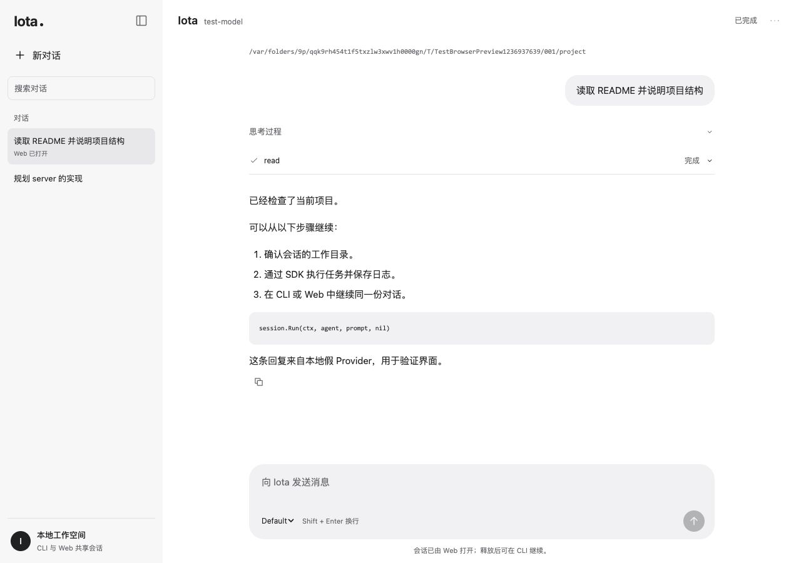
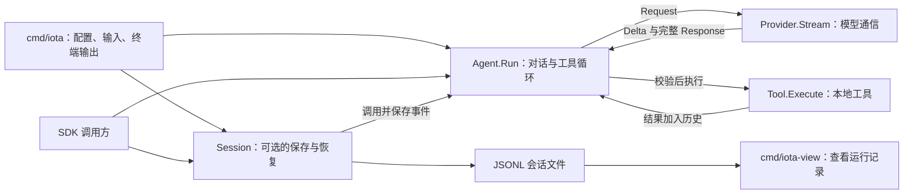

# iota

iota 是一个精简的 Go Agent SDK，以及使用该 SDK 构建的命令行和 React Web 编程助手。它保留 Agent 的必要闭环：请求模型、校验并执行工具、把工具结果交回模型，再得到最终回答。CLI 独立运行；Web 通过 HTTP Server 调用同一个 SDK。

项目只支持 OpenAI 兼容 Chat Completions 协议。SDK 默认在内存中保存对话，也提供可选的 JSONL 会话保存和恢复。CLI 使用同一套会话能力，记录可供查看器观察。支持手动上下文压缩和上下文超限后的自动恢复；不包含 TUI、插件、MCP 或多 Agent。

## 安装与 CLI

```sh
go install github.com/unimpl/Iota/cmd/iota@latest
```

至少配置模型名。官方 OpenAI 地址是默认地址，其他兼容服务可设置 `OPENAI_BASE_URL`：

```sh
export IOTA_MODEL=gpt-5-mini
export OPENAI_API_KEY=...

iota -p "解释这个仓库的结构"
printf '列出当前目录中的 Go 文件' | iota
iota
```

CLI 也支持 TOML 配置文件。启动时优先读取 `~/.iota/config.toml`；该文件不存在时，读取启动目录中的 `config.toml`。两个文件不会合并。环境变量覆盖配置文件，显式命令行参数再覆盖环境变量。

```toml
model = "gpt-6-sol"
base_url = "https://api.openai.com/v1"
api_key = "$API_KEY" # 运行时读取该环境变量，不把凭据写入文件
cwd = "."
system = "回答前先读取相关文件。"
tools = ["read", "list", "search", "find_files", "write", "edit", "bash", "save_plan", "update_progress", "search_history", "read_history", "request_user_input", "read_skill", "read_skill_resource", "install_skill"]
mode = "default" # plan 表示先探索和编写计划
max_turns = 100
timeout = "2m" # 模型响应等待/空闲超时；bash 命令总时长上限
save_session = true # false 表示只保留内存对话
compaction_keep_recent_tokens = 8000 # 以完整模型轮次保护最近原文
compaction_target_ratio = 0.20 # 自动压缩后的上下文目标比例
```

`api_key` 支持 `$NAME` 和 `${NAME}` 形式的环境变量引用；变量不存在时会报错。`OPENAI_API_KEY` 仍可直接覆盖它。其他可用环境变量为 `IOTA_MODEL`、`OPENAI_BASE_URL`、`IOTA_CWD`、`IOTA_SYSTEM`、`IOTA_TOOLS`、`IOTA_MAX_TURNS`、`IOTA_TIMEOUT`、`IOTA_SAVE_SESSION`、`IOTA_RESUME` 和 `IOTA_MODE`。`IOTA_TOOLS=none` 禁用全部工具，包括计划工具。未知 TOML 字段、非法时长、模式和非正数轮数会作为配置错误退出。

CLI 支持 `~/.iota/SYSTEM.md` 和工作目录中的 `.iota/SYSTEM.md`：找到的文件替换内置系统提示。`APPEND_SYSTEM.md` 放在对应的 `.iota` 目录中，用于追加提示。两种文件分别查找，均以工作目录为先、用户目录为后；工作目录的空 `SYSTEM.md` 会使用内置提示，不再查找用户目录的同名文件。`--system`、配置文件中的 `system` 和 `IOTA_SYSTEM` 仍作为额外提示，位于 `APPEND_SYSTEM.md` 之前。工作目录根部的 `AGENTS.md` 最后加入。启动和每次正常模型请求都会读取这些文件，压缩后仍重新注入当前规则。读取已存在的提示文件失败会报错。

`timeout`、`IOTA_TIMEOUT` 和 `--timeout` 对模型请求限制的是等待响应及连续没有收到响应数据的时间，默认 2 分钟。收到响应头后重新计时，随后每次读到响应字节都会重置计时，包括正文、推理、SSE 心跳和尚未收完整的事件。持续输出可以超过 2 分钟；无数据时取消该请求，错误明确标注 `response idle timeout`，不接受不完整的回复或执行其中的工具调用。同一设置对 bash 仍表示命令的总时长上限。

交互模式逐行接收任务，支持 `/reset`、`/compact [摘要重点]`、`/skill [list|reload|install <提示词>]`、`/thinking line <行数|all>`、`/exit` 和下述规划命令。模型文本写入 stdout，推理、提示符、工具状态和错误写入 stderr。

### 代码搜索与文件查找

CLI 默认提供两个只读工具，Plan 和 Default 模式均可使用：

- `search` 搜索内容，返回 JSON 中的路径、行号和匹配行。`pattern` 默认按字面量匹配，`regex = true` 启用正则，`ignore_case = true` 忽略大小写，`glob` 限定文件路径。
- `find_files` 按 `pattern` 中的 glob 查找路径，例如 `*.go` 或 `**/config*.go`，返回 JSON 文件列表。

`path` 默认是工作目录。工具遵守 `.gitignore`、`.ignore` 和 `.rgignore`，默认跳过隐藏文件，`hidden = true` 可包含隐藏文件，但仍排除 `.git`；不跟随符号链接。结果按文件路径排序，`offset` 是从 1 开始的结果位置，`limit` 默认 100、最多 2000；输出还有 50 KiB 上限。`truncated = true` 时，用相同条件和 `next_offset` 继续读取；文件变化可能改变分页结果。匹配行最多保留 4096 字节，`text_truncated` 表示需用 `read` 读取全文；单条原始记录超过 1 MiB 明确报错。搜索最多运行一分钟，无匹配是正常结果，非法正则、路径错误和进程失败是工具错误。

工具直接运行 ripgrep，不通过 shell。优先使用 PATH 中的 `rg`，其次使用 `~/.iota/bin/rg`；均不存在时，首次调用自动下载固定的 ripgrep 14.1.1，校验内置 SHA-256，再原子发布可执行文件。CLI 在 stderr 显示下载开始和安装完成，普通启动与禁用工具时不下载。下载最多两分钟，失败明确报告依赖不可用，无需管理员权限或修改 PATH。自动下载支持 macOS amd64/arm64、Linux amd64/arm64（arm64 包需要 glibc）和 Windows amd64；其他平台可以自行安装 rg。依赖下载支持不代表整个 CLI 已支持这些平台。

下载失败立即结束该工具调用，提示官方发布页和实际安装路径。用户可手动解压 `rg` 到 `~/.iota/bin/rg`（Windows 为 `rg.exe`），Unix 上赋予执行权限，或把 rg 安装到 PATH。工具不提供自行实现的内容搜索兜底。

文件模式支持 `*`、`?`、字符组和作为完整路径段的 `**`。不含 `/` 的模式匹配文件名，含 `/` 的模式匹配返回路径；`**` 匹配零个或多个目录段。路径过滤在 rg 的发现结果上执行，不覆盖忽略规则。

SDK 用 `tools.NewSearch(cwd, tools.RipgrepConfig{})` 和 `tools.NewFindFiles(cwd, tools.RipgrepConfig{})` 注册工具。配置中的 `Path` 可指定已有可执行文件并禁用自动下载，`BinDir` 覆盖缓存目录，`OnStatus` 接收下载状态；SDK 不自动打印。

### Skills

SDK 在创建 Agent 时扫描 `~/.iota/skills` 下的技能目录，将标准 [Agent Skills](https://agentskills.io/specification) 的元数据和 `SKILL.md` 原文注册到内存。每个技能放在 `~/.iota/skills/<name>/SKILL.md`，可附带 `references/`、`scripts/`、`assets/` 等文件；支持链接到技能目录的符号链接。发现过程不创建目录或下载技能。复制或链接技能目录后，在交互 CLI 输入 `/skill reload` 即可重新加载，无需重启；`/skill` 或 `/skill list` 查看技能及加载诊断。

`/skill install <提示词>` 提交一条安装任务，例如 `/skill install 安装一个用于 Go 代码审查的 skill`，或提供技能来源 URL、本地目录及选择条件。SDK 保留原始命令作为用户消息，首次请求附加安装流程指令；CLI 使用普通执行流程处理输出和取消。模型通过 `bash` 执行 `curl`、`wget`、`git` 或解压命令，将包含 `SKILL.md`、引用、脚本与资产的完整技能包准备到临时目录，再调用：

```json
{"source_dir":"/tmp/downloaded-skill"}
```

`install_skill` 只接受本地绝对目录，负责校验标准格式、根据元数据名称复制到 `~/.iota/skills/<name>`、记录安装事件，并立即刷新内存注册表。临时源目录名称可以不同于技能名称，目标目录由 SDK 选择。安装成功后的下一轮请求即包含新技能目录和读取工具；无需额外 `/skill reload`，也不会自动激活新技能。该工具在没有任何已安装技能时仍开放，Default 模式可安装，Plan 模式不可安装。

安装保留二进制资产和脚本执行位，跳过 `.git`，不下载、不执行包内脚本或安装依赖。已有目标目录拒绝覆盖；资源符号链接和特殊文件拒绝安装，包大小最多 128 MiB，文件与目录最多 4096 项。正文与资源在暂存目录准备好后，最后发布 `SKILL.md`，避免扫描到不完整包；失败时清理本次目标和暂存目录，保留源目录及已有技能。

```markdown
---
name: code-review
description: Review code changes for correctness and regressions.
---
Read the changed files in full, then report actionable findings.
```

前置 YAML 支持 `name`、`description`、`license`、`compatibility`、`metadata` 和 `allowed-tools`。名称必须与目录一致，使用 1–64 个小写 Unicode 字母、数字和单个连字符，按标准参考实现进行 NFKC 规范化；描述是非空字符串，最多 1024 个字符。非法技能会被跳过并显示诊断；目录读取失败则保留旧注册表。`allowed-tools` 作为元数据保留，不授予权限或改变当前模式。

输入 `请使用 $skill:code-review 检查修改`，SDK 会保留原始输入，并在首次模型请求前加载完整正文；支持同一输入选择多个技能，重复提及只加载一次。未知或非法技能名会报错，整条输入不会加入历史；`\$skill:code-review` 可作为字面量输入。模型隐式使用时，根据系统提示中的名称和描述选择技能，调用 `read_skill` 加载完整指令。完整技能正文不会作为整个目录的系统提示预先注入。

`read_skill_resource` 接受已激活技能名和相对路径，按需读取引用文件或脚本源码；不执行脚本。路径与符号链接不能越出该技能目录，只接受不超过 1 MiB 的 UTF-8 文本。二进制资产及脚本执行使用现有文件/执行工具，仍受协作模式和工具配置约束。两个读取工具和 `install_skill` 默认在 CLI 启用，在 Plan 与 Default 都可读取；`--tools none` 同时禁用模型的技能工具及安装子命令，显式技能选择仍由 SDK 处理。

技能激活记录为 `skill_activated`，包含 `source: user|model`、路径、正文 SHA-256 和完整原文。资源读取记录为 `skill_resource_read`，注册表重载记录为 `skills_reloaded`；安装记录为 `skill_installed`，包含源目录、安装位置、正文哈希与刷新后的技能目录。调用与失败另有普通工具事件。启用 Session 时写入 JSONL，无 Session 时由 SDK 回调接收。恢复会话不会重新安装历史技能。

已激活技能的原文版本独立于摘要保存：旧工具结果裁剪跳过技能正文；正文被摘要移出历史后，SDK 在临时运行时消息中恢复完整原文，正文仍在历史中时不重复注入。摘要只记录用户选择、相关决定和工作进度，不改写技能步骤。恢复会话使用当时记录的版本，即使磁盘技能已修改或删除也能继续；`/skill reload` 更新后续激活使用的版本，再次显式选择或调用 `read_skill` 才替换活动版本。引用资源按读取时的磁盘内容返回，可在压缩后重新读取。

活动技能保留至 `/reset`，只适用于相关任务，不将旧技能任务自动带入新请求。完整正文计入压缩预算；必要指令本身超出窗口时明确报错，不静默丢弃。

### 上下文压缩

详细规则见 [上下文压缩策略](docs/context-compaction.md)。`/compact` 和上下文溢出后的自动恢复共用同一套保护规则：按模型 turn 从最新消息向前累计，默认至少保护约 8000 token，并扩展到完整 turn 的边界。一个 turn 是一次模型回复及其完整工具结果，回复前的用户消息归入该 turn。`compaction_keep_recent_tokens` 可在 TOML 中设置正整数；受保护原文不会被裁剪或摘要。若没有更旧的内容可处理，压缩明确失败。

旧工具结果仍保留首尾各 1000 个字符和原始来源地址。手动压缩若裁剪已让整个请求的字符数减少至少 20%，可以直接使用裁剪结果；否则将上一份结构化摘要与本次待压缩原文一起交给模型，生成完整的新摘要。turn 只负责划分来源，不要求逐 turn 输出摘要。结构统一包含目标、约束与条件、进度、关键决定、下一步、关键上下文、待确认，重要条目允许必要长度。一个 session 只有最新一份摘要进入模型上下文，旧检查点和原文仍保留在 JSONL。已保存计划、批准和执行清单继续作为独立的权威状态提供。

摘要提示只把历史作为数据处理，模型不获得工具。旧条目以稳定 ID 引用，新原文以程序分配的 turn ID 引用。程序校验输出字段、引用、旧条目的明确处理、变更原因和状态转换，再绑定真实 `seq`、`run_id`、`step_id`；旧条目的原始来源继续继承，不能替换为上次检查点的地址。遗漏旧目标或约束、未知引用、重复处理、没有新证据的完成或验证升级会拒绝整次压缩。程序能验证地址和结构，不能证明原文在语义上支持每项陈述。摘要读取裁剪前的完整工具结果；启用 Session 时，从 JSONL 恢复已裁剪过的输出。输入可以放进摘要模型窗口时优先一次联合处理；只有窗口不足时才按完整 turn 分批，每批更新候选完整摘要，所有批次成功才一次生效。单个 turn 仍过大时使用明确标记不完整的摘录并保留原文来源。

合并时新事实补充已有事实；无法解释的矛盾保留双方和来源，标记待确认。未在新历史出现的用户约束继续有效，只有明确变更或适用条件确实终止才替换。决定更新必须保留变更原因和被替代的选择。修改、执行、局部验证和完整验证分别记录，不能把计划写成完成，或把局部测试通过写成全部验证通过。

自动压缩从服务端错误中取得已知上下文容量；若没有容量数字，用被拒绝请求的估算 token 数计算目标并标记为估算。`compaction_target_ratio` 默认 0.20。预算覆盖系统规则、工具定义、结构化摘要、近期原文和运行时状态。超过目标时，最多三次改写完整摘要，先去重和压缩表达，只归档低价值的关键上下文细节，保留有效目标、约束、当前决定及原因、未完成步骤、必要验证证据和冲突状态；不再按时间删除普通摘要。必要状态使目标无法达到时报告实际估算用量；仍可应用校验通过、请求变小且未超过已知窗口的候选。手动压缩只要求候选完整请求比原请求更小；未变小、失败或取消都不替换当前历史。

`compaction_prepared` 记录选中的旧历史与 turn 来源和保护范围；`compaction_progress` 报告联合摘要请求、降级分批或摘录、合并校验和预算检查。终端在 stderr 显示进度和估算 token 用量，模型正文不混入这些提示。成功检查点写入 JSONL；启用 Session 且生成摘要时，还写入只供阅读的 `*.summary.<event-id>.md`。`read_history` 按来源地址分页读取原文；`search_history` 按关键词搜索原始消息和归档的历史摘要细节，后者在 `summary_matches` 中返回原始来源。两种工具仅在持久化 Session 中可用。旧的普通摘要/重要状态格式不兼容；恢复含旧压缩检查点的日志时明确报错，避免静默丢失历史。

压缩不会改变当前模式、计划批准或执行进度。系统规则和规划模板在下一次正常请求重新加载；计划、批准和进度从尾部的临时 `runtime-context` 提供。系统规则或重要状态自身超过窗口时，历史压缩无法解决，应明确报错。`/reset` 清空当前上下文与协作状态，但会话 JSONL 保留先前记录。

### 规划与执行

Iota 内置 `plan` 和 `default` 两种协作模式。启动时默认使用 `default`；`--mode plan`、`IOTA_MODE=plan` 或配置文件中的 `mode = "plan"` 可以选择规划模式。

| 命令 | 行为 |
| --- | --- |
| `/plan [任务]` | 进入规划模式；可同时提交一条规划任务 |
| `/default [任务]` | 返回默认模式；可同时提交一条执行任务 |
| `/plan off` | 返回默认模式 |
| `/mode [plan\|default]` | 查看或切换模式 |
| `/execute` | 读取并批准当前计划，切换到默认模式，然后执行 |

规划模式只声明和执行只读工具与 `save_plan`，禁用 `write`、`edit`、`bash` 和 `update_progress`。`list` 列出目录，`read` 读取文件，模型可据此探索和讨论。随后调用 `save_plan`，传入以 Markdown 标题开头的完整计划；工具不接受目标路径。计划写入用户目录的 `~/.iota/plans/<plan-id>.md`，同一计划的修订继续写入该文件。保存后保持规划模式，不自动开始执行。

默认规划模板位于用户目录的 `~/.iota/plans/template.md`，包含“确认现状 → 澄清目标与选择 → 形成实施方案”的流程，以及计划文档结构。进入 `/plan` 时检查该文件，缺失则从随程序打包的默认模板创建；已有文件不会被覆盖。每次规划请求重新读取模板，修改后的内容在下一次请求生效。仓库的 `iota/plans/template.md` 是打包资源，不是运行时的项目配置。空文件、无效 UTF-8 或读取失败会报错，不会静默替换用户的模板。默认模式不读取或创建此文件。

交互模式中，模型主动提问并等待用户回答时使用 `request_user_input`，包括任务澄清、游戏和闲聊；Plan 和 Default 都可使用。一次调用支持多个独立问题，每题有稳定 ID 和正文。调用必须明确提供 `format`：

| 格式 | 问题参数 | 输入行为 |
| --- | --- | --- |
| `structured` | 收集任务信息和选择方案；每题有 2–3 个带取舍说明的选项及 `recommended_option_id` | 推荐项排第一位；有效编号选择选项，其他非空文本是自定义答案，直接回车或空白采用推荐项 |
| `freeform` | 游戏、闲聊和开放问答；只提供问题 ID 和正文，不提供选项或推荐项 | 非空文本原样作为自由答案，包括数字；直接回车或空白只表示用户没有回答 |

选项规则只约束结构化调用，不用于普通回复或自由提问。CLI 单独展示“Assistant question”提问区、输入调用和问题进度，问题使用助手颜色，`[you:answer] >` 使用用户颜色；不把工具参数 JSON 打印到终端。禁用颜色后仍保留提问区和角色标识。答案作为当前调用的工具结果返回，不创建新 Run；依赖前一答案的问题需要下一轮模型请求。

同一回复中的多个提问工具按顺序执行，每个结果立即写入启用的会话，整批工具处理完后再把所有结果交给模型。结果按问题 ID 记录 `option_id`、`value` 和 `source`（`selected`、`recommended`、`custom`）；空的自由回复返回 `source: "unanswered"`，不推断答案、跳过意图或同意，也不取消 Run。用户明确取消时，尚未回答的问题标记为 `cancelled`。Esc、Ctrl+C 或输入结束会保留已答内容，补齐尚未执行的工具结果，并以 `aborted` 结束当前 Run，不再请求模型；交互 CLI 随后返回任务提示符。取消不撤销已完成操作。等待用户不使用模型请求的超时。

`-p` 和管道输入属于非交互模式，不声明或执行该工具。系统指令要求模型不要提出问题后等待回答：信息足够时直接处理，合理默认值需说明；缺少必要信息或授权时说明原因并结束运行。无输入渠道不等于用户接受推荐。交互模式显式禁用或未选择该工具时，同样不提供提问能力。已有用户规划模板不会被覆盖，运行时会补充当前输入能力及其规则。

可以直接编辑计划文件，然后输入 `/execute`。Iota 会重新读取文件，将实际批准的内容及正文哈希记录到日志并交给模型执行。默认模式的 `update_progress` 用于创建和更新完整执行清单：步骤状态为 `pending`、`in_progress` 或 `completed`，最多一个步骤处于 `in_progress`；它不改写 Markdown 计划文件。首次省略清单和步骤 ID，由程序分配；后续传入清单 `id`、保留已有 `step_id`，新增步骤省略 ID。清单版本由程序递增，工具结果只确认保存，最新完整状态从请求尾部加载。规划模式提示符为 `[you:plan] >`，计划路径和步骤状态写入 stderr。

默认模式每个 run 仅在第一次模型请求附加任务判断与复杂任务拆分提示，后续请求保留执行、更新与必要修订规则。超限恢复重试仍属于同一个模型轮次。用户输入“继续”“go on”“continue”时，模型结合恢复出的 progress、plan、批准信息与最近对话处理；未完成清单沿用稳定 ID，中断步骤先核实实际结果。规划模式继续完善方案。不存在 `/continue` 命令。

`/default` 保留历史和计划文件，只解除当前规划模式的限制，不代表批准、取消或开始执行。默认模式的提示明确要求回应最新消息，不把保存的计划自动当成当前任务，也不反复催促批准。`/execute` 只在规划模式且已有保存计划时有效；已返回默认模式的用户可先 `/plan` 再 `/execute`，或直接提出新的工作请求。

启用会话保存时，模式变化、计划保存、计划批准和步骤更新分别写为 `mode_changed`、`plan_saved`、`plan_approved` 和 `progress_updated`。记录包含完整协作状态、计划正文和步骤，工具调用与失败也保留原有事件。恢复会话时重放这些记录，并恢复缺失的计划文件；已有文件的人工修改会保留。计划存储不依赖工作目录，CLI 可以在切换目录后恢复同一份用户计划；文件工具仍使用当前工作目录。显式配置模式会覆盖恢复的模式；未指定模式时沿用日志中的状态。

`/reset` 清空对话和当前计划、进度及批准状态，保留所选模式及已生成的计划文件；旧记录仍留在 JSONL 中。`--no-session` 仍能生成计划文件，但不保存会话日志。

工具名已由 `update_plan` 改为 `update_progress`，事件名已由 `plan_updated` 改为 `progress_updated`，不提供旧名称别名。配置需要使用新工具名；包含旧 `plan_updated` 事件、或缺少版本批准信息的旧 `plan_approved` 快照的日志恢复时明确报错，避免静默丢失进度或授权信息。

终端输出按角色区分颜色和格式：

| 内容 | 颜色与格式 |
| --- | --- |
| 用户输入 | 绿色，提示符为加粗的 `[you] > ` |
| 模型正文 | 青色，每段回复以加粗的 `[assistant]` 开始 |
| 思考过程 | 灰色，保留 `[thinking]` 与 `[/thinking]` 分段标识 |
| 工具调用 | 黄色，显示工具名及参数；bash 显示实际命令 |
| 错误 | 加粗红色 |
| 会话路径、恢复命令、重置提示 | 灰色 |

stdout 和 stderr 分别判断是否连接终端；重定向的输出不添加颜色，重定向的 stdout 也不添加回复标识或段落换行。设置非空的 `NO_COLOR`（例如 `NO_COLOR=1 iota`）或 `TERM=dumb` 可禁用颜色，终端中的角色标识仍然保留。颜色仅用于展示，不进入模型消息或会话日志。

终端中的工具调用保持单行显示：根据 stderr 当前终端宽度，将工具名和参数一起截断，超出部分显示 `…`，并预留右侧一列避免自动换行。JSON 参数压成单行，bash 命令中的换行、回车和制表符显示为 `\n`、`\r`、`\t`。中文与组合字符按显示宽度计算；完整参数仍保留在模型请求和 session 日志中，重定向 stderr 时输出完整内容。

`/thinking line 10` 将每段思考显示为滚动窗口，只保留最近 10 个显示行；长行按终端宽度换行，中文与组合字符按显示宽度计算。窗口只重绘当前 `[thinking]` 区域，结束后保留最后几行和 `[/thinking]`，不覆盖之前的正文或工具信息。终端高度不足时，窗口缩小到可用行数。

`/thinking line 0` 隐藏思考正文，只显示开始与结束标识；`/thinking line all` 恢复现有的完整流式输出，也是默认值。`/thinking` 查看当前设置。设置只影响当前 CLI 进程中的后续任务，`/reset` 保留设置，重新启动后恢复 `all`；命令不发给模型，不改变 SDK 行为、模型请求或 session 中的完整思考事件。stderr 被重定向或 `TERM=dumb` 时，有限行数模式在每段思考结束时输出保留内容，不发送光标控制序列。

CLI 默认创建一个 session ID，并将记录写入 `~/.iota/sessions/YYYY-MM-DD-<uuid>.jsonl`。交互模式的多次任务共用该文件，每次任务有独立 run ID。文件包含用户消息、模型请求、文本增量、完整回复、工具调用与结果、用量、取消、错误和重置事件。工具内部的实时输出不单独记录；工具最终返回的内容会记录。文件只允许当前用户读写。CLI 启动时在 stderr 打印文件路径，退出时打印可复制执行的恢复命令。

使用 `iota --no-session` 关闭保存，或 `iota --resume /path/to/session.jsonl` 恢复已有对话和协作状态并继续向原文件追加。两者不能同时使用。配置文件也支持 `save_session = false` 和 `resume = "/path/to/session.jsonl"`。模型、Provider、系统提示和工具使用当前配置。中断后未记录结果的工具调用会补为错误结果，不会重新执行工具。损坏的日志会报错，不覆盖文件。

`iota --resume <uuid>` 在 `~/.iota/sessions` 中查找文件名包含该 UUID 的 JSONL 文件，多个匹配时选最近修改的文件。`--resume` 必须传值；`iota --resume=""` 恢复该目录中最近修改的会话。没有匹配会话时会报错，不创建新会话。配置文件和 `IOTA_RESUME` 的非空值也支持 UUID。

使用独立查看器浏览这些记录：

```sh
go run ./cmd/iota-view
go run ./cmd/iota-view --folder /path/to/sessions
```

查看器默认读取 `~/.iota/sessions`，从 `127.0.0.1:9280` 开始监听；端口被占用时逐个尝试后续端口，并打印实际访问地址。网页默认选中最近创建的 session；左侧列表可以隐藏和切换，每项的删除图标经确认后永久删除对应文件。删除当前 session 后自动选择剩余列表的第一项。切换后会加载所选文件并实时跟随新增记录。详情按文件中的完整事件顺序展示时间线，包括任务与轮次边界；连续的文本增量合并为一个可展开节点，并标出序号范围。模型请求、工具参数和结果等过程内容默认折叠，原始 JSON 可按需展开。查看器仅监听 `127.0.0.1`，不向 Agent 发送命令。

长任务的实时更新只追加新节点和更新当前流节点，保留历史详情的展开状态；首次加载大日志时分批生成时间线。流片段详情每页显示 100 条，可翻页或跟随最新片段，完整记录仍可查看。SSE 按批发送，并在断线后从最后收到的完整记录继续，避免重复加载整个文件。

主要选项：

```text
--model       模型名
--base-url    OpenAI-compatible API 根地址
--cwd         工具工作目录
--system      附加系统提示
--max-turns   每次运行最多模型轮数，默认 100
--timeout     模型响应等待/空闲超时；bash 命令总时长上限，默认 2m
--tools       read,list,search,find_files,write,edit,bash,save_plan,update_progress,search_history,read_history,request_user_input,read_skill,read_skill_resource,install_skill 的逗号列表；none 表示禁用
--mode        default 或 plan
--no-session  关闭会话保存
--resume      按路径或 UUID 恢复会话；传空字符串时恢复最近修改的会话
```

CLI 默认配置文件工具、`save_plan`、`update_progress`、两个历史工具、`request_user_input` 和三个技能工具；实际开放的工具由当前模式、Session、已安装技能及交互能力决定。工具使用当前进程权限；规划模式的工具检查不是操作系统沙箱。

## HTTP Server 与 Web

```sh
go run ./cmd/iota-server
```

默认监听 `http://127.0.0.1:9281`，React 客户端随 Go 程序嵌入，无需单独启动 Node 服务。Server 与 CLI 共用配置加载、系统提示、工具初始化和 `~/.iota` 下的 sessions、skills、plans；Web 使用 ChatGPT 风格的聊天布局，支持流式回复、工具与思考详情、规划与批准执行、进度、压缩、重置、skills 和用户提问。



上图使用本地假 Provider 验证界面，展示会话列表、工具执行状态、回复和消息输入。

查看历史不占用会话；点击“打开会话”后持有独占锁，另一端打开同一 session 会返回占用错误。空闲时切换会话会释放旧会话；运行中切换只改变展示，后台任务继续。刷新、断线和关闭浏览器不会取消任务或释放会话。使用“停止任务”取消，再通过会话操作中的“释放会话”交给 CLI。打开已有会话时，Server 使用日志记录的原工作目录；CLI 恢复仍遵守现有 `--cwd` 行为。

Server 只提供 HTTP。通过网关使用 HTTPS 时，设置公开 Origin，并关闭网关的 SSE 缓冲：

```sh
go run ./cmd/iota-server --listen 127.0.0.1:9281 --origin https://iota.example.com
```

Server 必须与 CLI 使用同一用户和文件系统才能共享会话。模型凭据与配置引用的环境变量只在服务端读取。Web 需要会话持久化；配置为 `save_session=false` 时，Server 明确报错。详细接口、生命周期和开发方式见 [Server 架构与协议](docs/server.md)。

## SDK

```go
provider, err := openaicompat.New(openaicompat.Config{
    APIKey: os.Getenv("OPENAI_API_KEY"),
})
if err != nil {
    log.Fatal(err)
}

agent, err := iota.New(iota.Config{
    Provider: provider,
    Model:    os.Getenv("IOTA_MODEL"),
    Tools: []iota.Tool{
        tools.NewRead("."),
        tools.NewWrite("."),
        tools.NewEdit("."),
        tools.NewBash(".", 2*time.Minute),
    },
})
if err != nil {
    log.Fatal(err)
}

result, err := agent.Run(context.Background(), "解释 README", func(event iota.Event) {
    if event.Type == iota.EventTextDelta {
        fmt.Print(event.Text)
    }
})
```

`openaicompat.Config.Timeout` 的零值使用默认 2 分钟，正值设置响应等待与读取空闲超时；负值报错。Provider 不设置模型流的总时长上限。调用方传入的 context 截止时间及自定义 `HTTPClient.Timeout` 仍然有效，若设置了总时长上限，持续输出也可能到期停止。空闲监测通过请求自己的取消 context 实现，不修改共享 HTTP client 或连接的截止时间。

SDK 不读取 CLI 配置文件、配置环境变量、`AGENTS.md` 或终端。`cmd/iota` 和 `cmd/iota-server` 通过 `internal/app` 共用配置与初始化；其他 SDK 调用者显式注入 Provider、模型、系统提示和工具。SDK 默认不注册工具。

技能发现默认使用当前用户的 `~/.iota/skills`；`Config.SkillsDir` 可以指定其他目录，`Config.DisableSkills` 禁用发现、新激活和安装。SDK 调用方在 `Config.Tools` 注册 `iota.NewReadSkillTool()`、`iota.NewReadSkillResourceTool()`，才开放模型的隐式使用和资源读取；注册 `iota.NewInstallSkillTool()` 开放模型安装。显式 `$skill:name` 由 `Run` 处理。`agent.Skills()` 返回可用技能与诊断的独立副本，`agent.ActiveSkills()` 返回已激活的原文快照。

无持久化时调用 `agent.ReloadSkills(ctx, emit)`，启用 Session 时调用 `session.ReloadSkills(ctx, agent, emit)`，运行或压缩期间返回 `ErrBusy`。`agent.HandleSkillCommand(ctx, line, session, emit)` 返回 `SkillCommandResult` 和错误：`Handled` 表示已处理，`Output` 用于本地展示，`Prompt` 非空时由调用方交给 `Run` 或 `Session.Run`。SDK 负责 `/skill [list|reload|install <提示词>]` 的语法和任务准备，CLI 负责调用、展示及正常模型运行。安装命令内的 `$skill:name` 表示待安装目标，不在安装前激活。原文快照随 Session 恢复，注册表仍按当前配置重新发现。

调用方已有本地包时可直接使用 `agent.InstallSkill(ctx, sourceDir, emit)`；启用持久化时使用 `session.InstallSkill(ctx, agent, sourceDir, emit)`。这些 API 不调用模型、不下载，仅校验、复制、记录和刷新目录，返回 `SkillInstallation`。API 只在 Default 模式空闲时使用，忙时返回 `ErrBusy`；模型工具在当前 Run 内调用同一安装实现。

SDK 使用规划工具时，在 `Config.Tools` 中注册 `iota.NewSavePlanTool()`、`iota.NewUpdateProgressTool()`，并通过 `Config.PlansDir` 明确提供计划目录；可通过 `Config.Mode` 选择初始模式。自定义工具只有标记 `ReadOnly: true` 才能在规划模式执行，这个标记的真实性由工具实现方负责。

SDK 默认使用程序中打包的规划模板，不自动读取项目文件。传入 `Config.PlanTemplatePath` 可显式指定可编辑的模板文件，并启用缺失时创建及每次请求重新读取的行为；该路径与保存任务计划的 `PlansDir` 分别配置。

SDK 可注册 `iota.NewSearchHistoryTool()` 与 `iota.NewReadHistoryTool()`。`session.Run` 或 `session.Restore` 绑定它们的数据来源；读取仅限该 session，不接受任意文件路径。

SDK 注册 `iota.NewRequestUserInputTool()` 并设置 `Config.UserInputHandler` 才开放提问能力。回调接收 `UserInputRequest`：`Format`（`iota.UserInputStructured` 或 `iota.UserInputFreeform`）、完整 `Questions` 和工具批次内从 1 开始的 `CallIndex`、`CallCount`。调用方负责界面、等待和按格式处理空输入，不应再次调用 `Run`；回调必须响应传入 context 的取消。返回 `UserInputResponse.Answers`，选项答案提供 `OptionID` 及 `Source`，程序从原始选项补齐 `Value`；非空自由或自定义答案提供 `Value` 和 `Source: "custom"`。空的自由回复明确返回 `Source: "unanswered"`，不提供选项 ID 或非空值；省略答案不能代替该状态。`Cancelled: true` 或取消错误会停止当前 Run；回调仍应返回已经取得的部分答案。缺失或无效答案、界面错误会结束运行，避免模型绕过失败的交互继续执行。问题与结果使用普通工具事件记录，查看器无需专门的交互协议。

`agent.Collaboration()` 返回模式、计划及进度的独立副本。无会话保存时用 `agent.SetMode(mode, emit)` 切换模式，`agent.ApprovePlan(emit)` 批准计划；启用保存时对应调用 `session.SetMode(agent, mode, emit)` 和 `session.ApprovePlan(agent, emit)`。批准 API 只读取计划并切换模式，不自动运行模型；调用方随后用 `session.Run` 提交执行请求。

`Config.KeepRecentTokens` 设置最近原文的 token 保护目标，零值使用 `iota.DefaultKeepRecentTokens`（8000）；`Config.CompactionTargetRatio` 设置自动压缩后的窗口目标，零值为 0.20。无持久化时调用 `agent.Compact(ctx, instructions, emit)`；保存会话时调用 `session.Compact(ctx, agent, instructions, emit)`。这两个 API 在空闲时使用，返回包含有效上下文和前后大小的 `CompactionState`。自动恢复由 `Run` 内部处理。

SDK 的 `Session` 默认在会话文件所在目录保存 Markdown 快照；`session.SetSummaryDir(dir)` 可以显式指定目录。CLI 使用该接口固定为用户的 `~/.iota/sessions`，包括从其他目录恢复会话的情况。`CompactionState.EventID`、`SummaryPath`、`BeforeUsage` 和 `AfterUsage` 提供快照及用量信息。

`Run` 同步等待一次完整运行，同一个 Agent 不允许并发运行。工具调用只在完整模型响应返回后执行；未知工具、参数错误和工具失败会作为 tool result 交回模型。模型请求错误、响应异常结束、输出截断、取消或达到轮数上限会停止运行。

SDK 的事件回调同步发送，包含完整消息、每轮模型请求、文本增量、模型响应元信息、工具开始与结束，以及运行终态。

直接调用 `agent.Run` 不写文件。需要保存时，在调用方选择的目录创建 `Session`，再通过 `session.Run` 运行：

```go
session, err := iota.NewSession("./sessions", iota.SessionInfo{Model: "my-model"})
if err != nil {
    log.Fatal(err)
}
defer session.Close()

result, err := session.Run(ctx, agent, "解释 README", nil)
```

下次创建 Agent 后，打开会话、恢复历史，再继续运行：

```go
session, err := iota.OpenSession("./sessions/saved-session.jsonl")
if err != nil {
    log.Fatal(err)
}
defer session.Close()
if err := session.Restore(agent); err != nil {
    log.Fatal(err)
}
result, err := session.Run(ctx, agent, "继续之前的任务", nil)
```

保存期间使用 `session.Reset(agent)` 清空历史并保存重置事件。保存失败会作为运行错误返回，并取消本次运行。同一会话不支持同时运行、恢复、重置或关闭。`NewSession` 和 `OpenSession` 持有跨进程独占锁，直到 `Close` 或进程退出；另一 Agent 打开时返回 `ErrSessionOccupied`。只读查看日志不获取 Agent 所有权，`DeleteSession` 拒绝删除已打开的会话。恢复不会自动还原工具函数、凭据或工作目录，这些由创建 Agent 的程序决定；`session.Info()` 提供原模型与工作目录信息。

需要通过 UI 批准计划时，先用 `agent.PlanPreview()` 读取当前文件，展示正文，再把它的 SHA-256 交给 `session.ApprovePlanVersion(agent, hash, emit)`。文件变化时返回 `ErrPlanChanged`，不改变模式或批准状态。现有 `ApprovePlan` 继续读取实际文件并批准，供 CLI 的显式 `/execute` 使用。

参见 [`examples/basic`](examples/basic)、[`examples/custom-tool`](examples/custom-tool) 和 [`examples/session`](examples/session)。Session 示例完整演示保存、关闭会话，再用新 Agent 恢复历史并继续对话：

```sh
go run ./examples/session -dir ./sessions
```

## 核心代码阅读顺序



详细的运行分支、类型关系、事件顺序和恢复流程见 [核心流程与类型关系](docs/architecture.md)。Go 中的核心类型是结构体和接口，文档使用 Mermaid 类图表示它们的字段、方法和依赖。

先读 `agent.go` 的 `Run`：加入用户消息 → 请求模型 → 如果没有工具调用则返回回答 → 否则执行工具、加入工具结果，再请求模型。该文件保留运行状态、核心循环、消息追加和取消时补齐工具结果的代码。

其余代码按职责放在同一个 `iota` 包的其他文件中：

| 文件 | 内容 |
| --- | --- |
| `types.go` | 消息、工具、模型请求与回复、事件的数据结构，以及 Provider 接口 |
| `config.go` | Agent 配置、默认轮数和 `New` 初始化 |
| `tool.go` | 工具调用校验、参数校验与执行，以及工具 schema 的引用检查 |
| `user_input.go`、`cmd/iota/user_input.go` | 结构化提问、SDK 回调、交互输入与取消 |
| `messages.go` | 读取和清空历史，以及消息与工具调用的独立副本 |
| `skills.go`、`skill_tools.go`、`skill_install.go` | 标准技能发现、注册表重载、显式选择、读取工具、本地包安装、事件和正文恢复 |
| `compaction.go`、`context_overflow.go`、`model_request.go` | 分阶段压缩、超限错误识别、摘要及模型请求 |
| `context_usage.go`、`summary_snapshot.go` | 上下文用量估算和按检查点保存的 Markdown 摘要快照 |
| `collaboration.go`、`plan_file.go` | 内置协作模式、计划工具、文件保存与计划批准 |
| `plan_template.go`、`iota/plans/template.md` | 默认规划流程、选项与自定义回答指引、模板读取与初始化 |
| `session.go` | 可选会话保存、运行、重置和关闭 |
| `session_restore.go` | 读取会话、校验消息、处理中断后的工具结果缺失 |
| `session_lock.go` | 跨进程会话所有权、占用检查与删除保护 |
| `internal/app` | CLI 与 Server 共用的配置、工具、提示和规划命令 |
| `internal/server`、`cmd/iota-server` | HTTP 接口、会话生命周期、后台执行和 SSE |
| `web/src`、`web/dist` | React 聊天界面与嵌入程序的生成资产 |

## 开发

```sh
go test ./...
go test -race ./...
go vet ./...
node --test cmd/iota-view/*.test.mjs
cd web
npm ci --ignore-scripts
npm run check
node --disable-warning=ExperimentalWarning --experimental-strip-types --test model.test.mjs
node build.mjs
```

测试只使用假 Provider 和本地 HTTP 服务，不请求真实模型。
